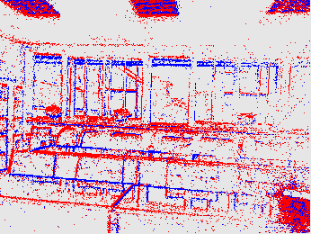
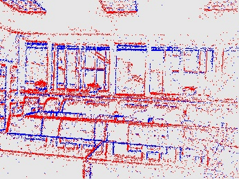
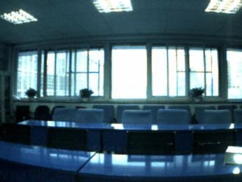

# ELIR: Identifying Light Interference in Event-Based Vision

[](https://ieeexplore.ieee.org/document/10325523)
[-orange)](https://drive.google.com/drive/folders/1ZR7PVGOUy9accqPIGM2zCWcwzFW0XgiG?usp=sharing)
[-orange)](https://ieee-dataport.org/documents/light-interference-event-dataset)

Official implementation of *"Identifying Light Interference in Event-Based Vision"*, published in **IEEE Transactions on Circuits and Systems for Video Technology**, Vol. 34, No. 6, pp. 4800–4816, 2024.

> © Beihang Vision Navigation Group. All rights reserved. For academic use only.

---

## Overview

Event cameras are highly sensitive to light intensity changes, which makes them susceptible to **light interference** — events triggered not by useful scene content but by light sources themselves (strobe lights, non-strobe lamps, scattered or reflected light). These spurious events corrupt downstream tasks and waste computational resources.

We propose **ELIR** (Event-based Light Interference Removal), a method for removing light interference signals from event streams under both static and dynamic scenes. Alongside ELIR, we release **LIED** (Light Interference Event Dataset), a real-world benchmark covering three categories of light interference combined with both fixed-camera and hand-held capture conditions.

For detailed algorithmic implementation, please refer to the [paper](https://ieeexplore.ieee.org/document/10325523).

---

## :dizzy: Demonstrations

### LIED — Sequence 26

| Original event frame | Our ELIR method |
|:---:|:---:|
|  |  |
| | |

### LIED — Sequence 9

| [Original event frame](https://drive.google.com/file/d/1G8RiuAw-2yv1AJ5nkbU9RHieBJCVqXbs/view?usp=drive_link) | [Our ELIR method](https://drive.google.com/file/d/1bMqvy3GvOGU1Hsuko9Bwn0aA4MmWz9JA/view?usp=drive_link) |
|:---:|:---:|
|  |  |

### EFR Dataset

ELIR also generalizes to the [EFR dataset](https://github.com/ziweiWWANG/EFR):

| Original event frame | Our ELIR method |
|:---:|:---:|
|  |  |

---

## :boom: LIED Dataset

**Download:**
- [Google Drive](https://drive.google.com/drive/folders/1ZR7PVGOUy9accqPIGM2zCWcwzFW0XgiG?usp=sharing)
- [IEEE DataPort](https://ieee-dataport.org/documents/light-interference-event-dataset)

### Capture Setup

All sequences were recorded with a **DAVIS346** sensor (346 × 260 resolution), which provides events, APS frames, and IMU data. The files can be viewed and decoded with [DV software](https://inivation.gitlab.io/dv/dv-docs/) and [DV-python](https://gitlab.com/inivation/dv/dv-python).

LIED contains **30 recordings** captured indoors and outdoors. The DAVIS346 was used in two configurations:

| Setup | Scene type | Motion |
|---|---|---|
| Fixed | Static | None |
| Hand-held | Dynamic | Various non-rigid camera motions, often at high speed to track moving objects |

### Composition

The dataset is organized into two parts:

- **Part 1 — Light interference only.** Covers all interference categories identified in the paper: strobe light sources (halogen lamp), non-strobe light sources, scattered or reflected light, and the edges of light sources. Each category is recorded under both fixed and hand-held conditions.
- **Part 2 — Light interference + dynamic objects.** Extends Part 1 by introducing high-speed moving objects into the scene. Captured exclusively under the hand-held condition, with the camera moving at relatively high speed to track the dynamic targets.

### Light Interference Categories

| Category | Examples |
|---|---|
| Strobe light sources | Halogen lamps |
| Non-strobe light sources | Steady-state lamps |
| Scattered / reflected light | Reflections off surfaces |
| Light-source edges | Boundary effects around the above |

---

## Citation

If you use the LIED dataset or use ELIR as a baseline, please cite:

> C. Shi *et al.*, "Identifying Light Interference in Event-Based Vision," in *IEEE Transactions on Circuits and Systems for Video Technology*, vol. 34, no. 6, pp. 4800–4816, Jun. 2024, doi: 10.1109/TCSVT.2023.3335457.

```bibtex
@ARTICLE{10325523,
  author  = {Shi, Chenyang and Li, Yuzhen and Song, Ningfang and Wei, Boyi and Zhang, Yibo and Li, Wenzhuo and Jin, Jing},
  journal = {IEEE Transactions on Circuits and Systems for Video Technology},
  title   = {Identifying Light Interference in Event-Based Vision},
  year    = {2024},
  volume  = {34},
  number  = {6},
  pages   = {4800-4816},
  doi     = {10.1109/TCSVT.2023.3335457}
}
```

---
